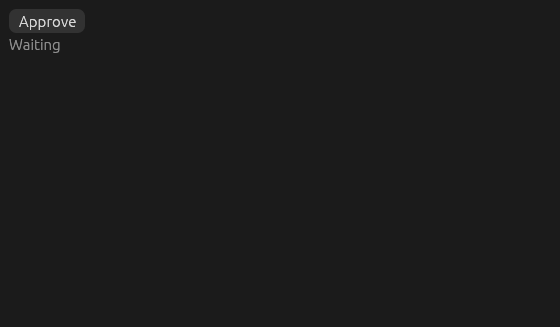

# Button



Click **Approve**. The successful `true` response changes **Waiting** to **Approved** before the label is drawn in the same pass. A later redraw keeps the new text without replaying the click.

From `examples/gui/egui_widgets`, run `plenty run --bin button`.

```plenty build
{{#include ../../../../../examples/gui/egui_widgets/src/button.plenty}}
```
