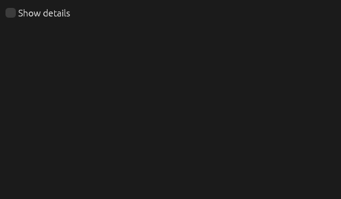

# Checkbox



The box updates the borrowed boolean in this pass. Its return value reports a change, not the new setting.

From `examples/gui/egui_widgets`, run `plenty run --bin checkbox`.

```plenty build
{{#include ../../../../../examples/gui/egui_widgets/src/checkbox.plenty}}
```
