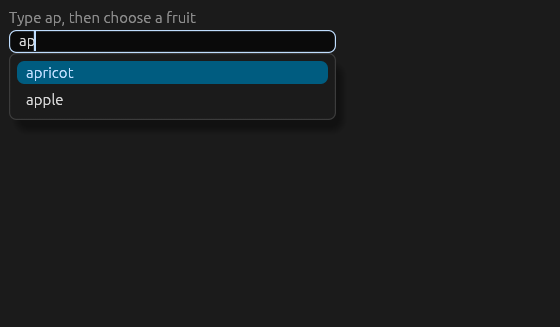

# Completion popup



Type **ap** to see apricot and apple. Use the arrow keys and Enter or Tab, or click a match. Accepting replaces the word before the cursor and returns true for that pass. Typing alone edits the Plenty string but does not signal acceptance.

Give each field a stable ID. Candidates are nonempty single-line strings; each uses one widget slot and its UTF-8 bytes from the pass budget. The editor uses the same limits and copyback rules as [TextEdit](text_edit.md). The binding uses egui’s CompletionQuery to match nonempty, case-sensitive word prefixes in list order; Suggestion labels equal their replacement text. It does not expose custom ranking, popup placement, descriptions, or the full CompletionOutput.

Run `plenty run --bin completion` from `examples/gui/egui_widgets`.

```plenty build
{{#include ../../../../../examples/gui/egui_widgets/src/completion.plenty}}
```
