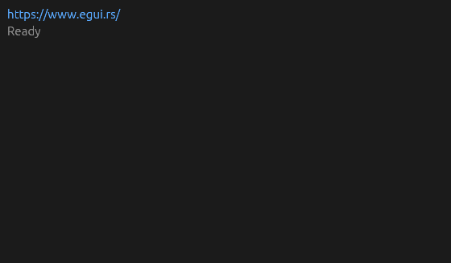

# Hyperlink



Display an absolute HTTP or HTTPS URL. Activating it asks the desktop to open the URL in the browser. A click response does not confirm that the browser opened. Whitespace, backslashes, credentials and other schemes are rejected. Use [Link](link.md) for an application action instead.

From `examples/gui/egui_widgets`, run `plenty run --bin hyperlink`.

```plenty build
{{#include ../../../../../examples/gui/egui_widgets/src/hyperlink.plenty}}
```
