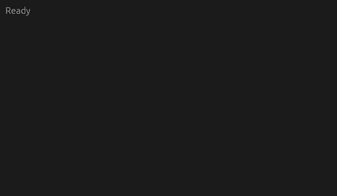

# Label



The label reads **Ready** from state on each draw. There is no label handle to keep or update.

From `examples/gui/egui_widgets`, run `plenty run --bin label`.

```plenty build
{{#include ../../../../../examples/gui/egui_widgets/src/label.plenty}}
```
