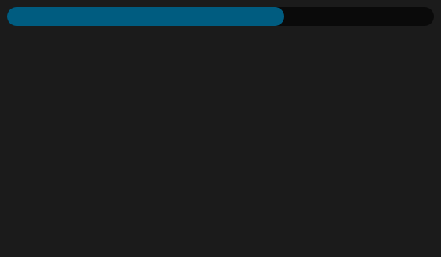

# ProgressBar



Draw a finite fraction from 0 through 1. An out-of-range value is InvalidArgument, not a clamped display.

From `examples/gui/egui_widgets`, run `plenty run --bin progress_bar`.

```plenty build
{{#include ../../../../../examples/gui/egui_widgets/src/progress_bar.plenty}}
```
