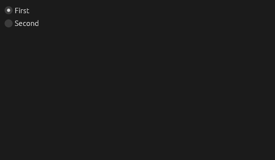

# RadioButton



Each button reports a click. Store the selection in the model so exactly one choice is active.

From `examples/gui/egui_widgets`, run `plenty run --bin radio`.

```plenty build
{{#include ../../../../../examples/gui/egui_widgets/src/radio.plenty}}
```
