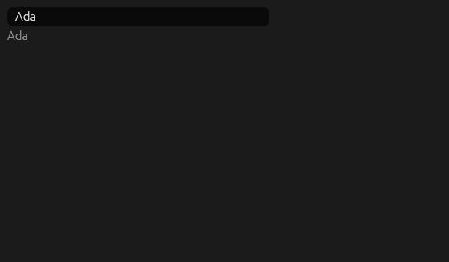

# Single-line text editor



Edit **Ada** and watch the label echo the current name without pressing Enter. Plain Enter also shows **Submitted** for that draw only. The fixed ID follows this field across redraws; the name itself must not be the ID.

From `examples/gui/egui_widgets`, run `plenty run --bin text_edit`.

```plenty build
{{#include ../../../../../examples/gui/egui_widgets/src/text_edit.plenty}}
```
