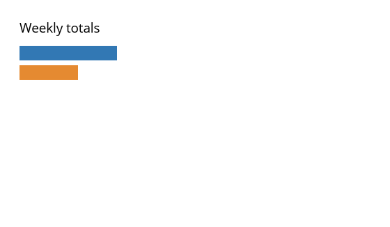

# Canvas



Use `canvas(width, height)` to start a drawing, `fill_rect` to paint opaque rectangles, and `end()` to close it. Coordinates are logical pixels from the top left. Rectangles paint in insertion order; colors are packed as `0xRRGGBB`. Canvas dimensions must be 1–2048; rectangle dimensions must be nonzero. Each rectangle counts toward the view’s node limit. This binding does not expose arbitrary paths or canvas input events.

From `examples/gui/iced_widgets`, run `plenty run --bin canvas`.

```plenty build
{{#include ../../../../../examples/gui/iced_widgets/src/canvas.plenty}}
```
