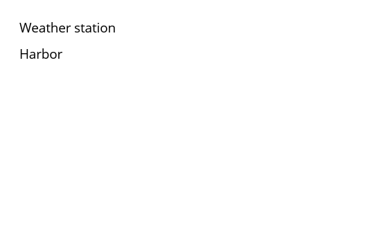

# Column



**Weather station** appears above **Harbor**. `end()` closes the most recently opened container; it is not a visible widget. The counter nests a row inside a column using the same rule.

From `examples/gui/iced_widgets`, run `plenty run --bin column`.

```plenty build
{{#include ../../../../../examples/gui/iced_widgets/src/column.plenty}}
```
