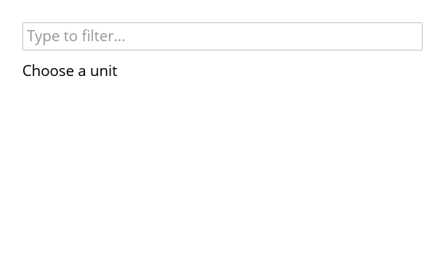

# ComboBox



Type to filter the options, then select a match. Like [PickList](pick_list.md), the group takes one or more `choice(label, action)` entries and ends with `end()`. The model supplies the selected choice ID (zero for no selection); accepting a match sends its action to update. Typing alone does not update the model. The search text belongs to iced and is not preserved when an application update replaces the snapshot.

From `examples/gui/iced_widgets`, run `plenty run --bin combo_box`. Type **Fah** to narrow the menu to Fahrenheit.

```plenty build
{{#include ../../../../../examples/gui/iced_widgets/src/combo_box.plenty}}
```
