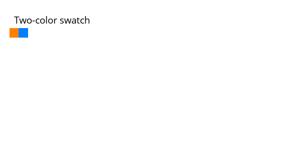

# Image



Display row-major RGBA bytes with straight alpha. The snapshot copies the pixels before the view returns. Width and height must each be 1–256 pixels, with four bytes per pixel. Text and image bytes share the 65,536-byte view budget. Scale is 1–16 logical pixels per source pixel (nearest neighbor). This binding does not decode files or fetch URLs.

From `examples/gui/iced_widgets`, run `plenty run --bin image`.

```plenty build
{{#include ../../../../../examples/gui/iced_widgets/src/image.plenty}}
```
