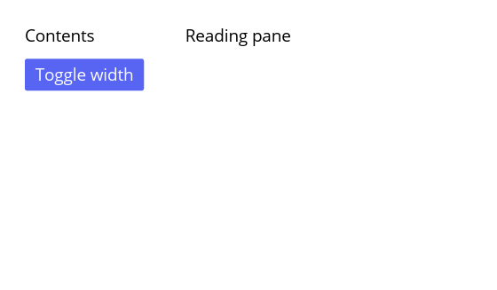

# PaneGrid



Start a two-pane split with `pane_grid(side_by_side, first_percent)`, add exactly two children, then call `end()`. The first child is on the left when side by side, or on top otherwise. Give it 1–99 percent of the split. Each pane can contain a group or another split.

Run `plenty run --bin pane_grid` from `examples/gui/iced_widgets`. **Toggle width** changes the first pane’s share in the Plenty model. Drag-to-resize and pane rearrangement are not exposed.

```plenty build
{{#include ../../../../../examples/gui/iced_widgets/src/pane_grid.plenty}}
```
