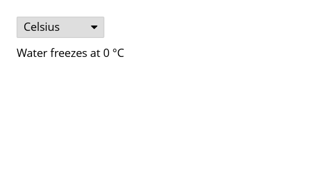

# PickList



Start a drop-down with `pick_list(selected)`, add one or more `choice(label, action)` entries, and close it with `end()`. Each choice needs a unique, nonzero action ID in the view. Pass a choice’s ID to display it as selected, or zero for the placeholder. Selecting a choice sends its action to `update`; the model decides which selection the next view shows.

From `examples/gui/iced_widgets`, run `plenty run --bin pick_list`. Add `-- --headless 2` to dispatch the Fahrenheit action without a window.

```plenty build
{{#include ../../../../../examples/gui/iced_widgets/src/pick_list.plenty}}
```
