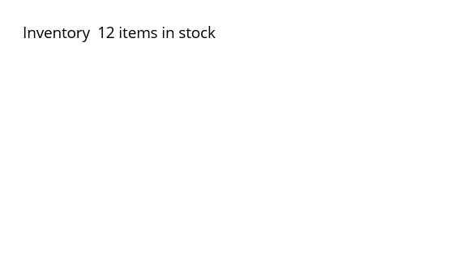

# Responsive



Resize the window: this group uses a row when its available width meets the threshold, otherwise a column. The threshold is measured in logical pixels. Both layouts retain the same children and action IDs. Close the group with `end()`.

From `examples/gui/iced_widgets`, run `plenty run --bin responsive`.

```plenty build
{{#include ../../../../../examples/gui/iced_widgets/src/responsive.plenty}}
```
