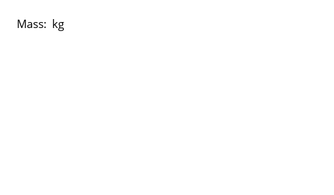

# Row



**Mass:** and **kg** are siblings on the same line. Start the row before either child and close it after both.

From `examples/gui/iced_widgets`, run `plenty run --bin row`.

```plenty build
{{#include ../../../../../examples/gui/iced_widgets/src/row.plenty}}
```
