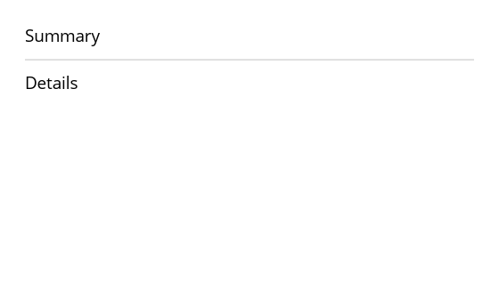

# Rule



Draw a horizontal divider between two sections.

From `examples/gui/iced_widgets`, run `plenty run --bin rule`.

```plenty build
{{#include ../../../../../examples/gui/iced_widgets/src/rule.plenty}}
```
