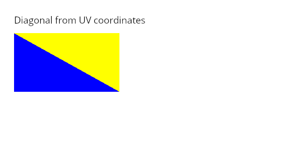

# Shader



Import `std.gui.retained.iced.shader` alongside iced to select the wgpu renderer **for this executable**. Ordinary iced imports still select tiny-skia. Run `plenty run --bin shader` from `examples/gui/iced_widgets` on a machine with a working wgpu adapter. The shader build has no tiny-skia fallback.

Supply a trusted WGSL fragment **expression**, not a complete shader module. Its input is `uv: vec2f`, from (0,0) at the widget’s top left to (1,1) at its bottom right. Return a `vec4f` color. The example compares the two coordinates to draw a diagonal. There are no application textures, bindings, vertex stages, statements, comments, or custom functions. The expression is validated before the snapshot is published; malformed input returns `InvalidArgument`. Dimensions are 1–2048 logical pixels and the normal text and node budgets apply. This is not a sandbox for untrusted shader input or a guarantee of recovery from GPU failure.

```plenty build
{{#include ../../../../../examples/gui/iced_widgets/src/shader.plenty}}
```

## Acknowledgements

- [iced](https://docs.rs/iced/0.14.0/iced/) supplies the Shader widget (MIT).
- [wgpu](https://docs.rs/wgpu/27/wgpu/) executes the graphics pipeline (MIT OR Apache-2.0).
- [Naga](https://docs.rs/naga/27/naga/) parses and validates WGSL (MIT OR Apache-2.0).
