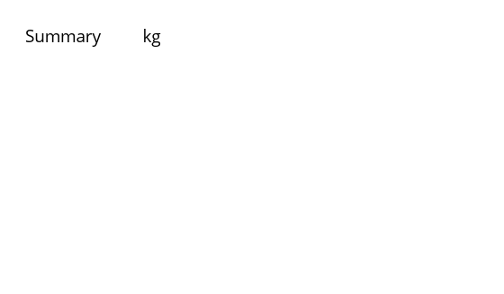

# Space



Insert a fixed-size gap, measured in logical pixels.

From `examples/gui/iced_widgets`, run `plenty run --bin space`.

```plenty build
{{#include ../../../../../examples/gui/iced_widgets/src/space.plenty}}
```
