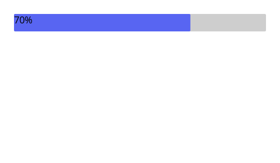

# Stack



Layers share one layout area. Later children paint over earlier children. Close the group with `end()`.

From `examples/gui/iced_widgets`, run `plenty run --bin stack`.

```plenty build
{{#include ../../../../../examples/gui/iced_widgets/src/stack.plenty}}
```
