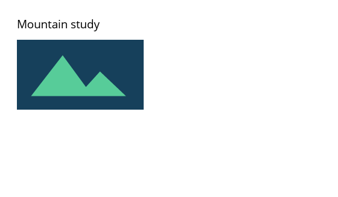

# Svg



Use `frame.svg(source)` to display trusted, self-contained SVG markup at its intrinsic size, subject to layout constraints. The snapshot copies the UTF-8 source: at most 4,096 bytes per widget, counted toward the frame’s 65,536-byte shared budget. This is not a file or URL loader, SVG validator, or sandbox for untrusted markup. A successful call records the widget; it does not guarantee that the renderer can display the document.

From `examples/gui/iced_widgets`, run `plenty run --bin svg`.

```plenty build
{{#include ../../../../../examples/gui/iced_widgets/src/svg.plenty}}
```
