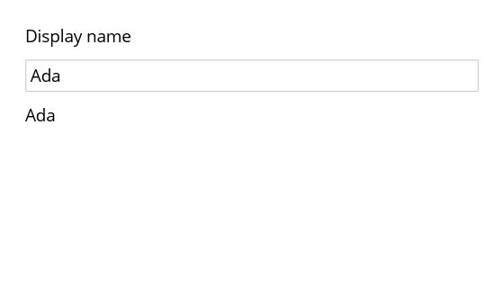

# TextInput



Run `plenty run --bin text_input` in `examples/gui/iced_widgets` and edit the display name. The read-only view presents the model’s current text. With `run_events`, each edit sends `TextChanged(id, text)` containing the proposed **whole string**; only update assigns the new name. The action-only runner rejects text events.

Keep the field’s nonzero ID unique and stable across views. Keeping its place in the layout preserves cursor and focus during ordinary updates; moving or removing it can reset editing state. Values are single-line UTF-8, at most 4,096 bytes; snapshots also share the frame byte budget. An oversized edit returns `LimitExceeded` rather than truncating the proposal. There is no submit event or multiline support.

```plenty build
{{#include ../../../../../examples/gui/iced_widgets/src/text_input.plenty}}
```
