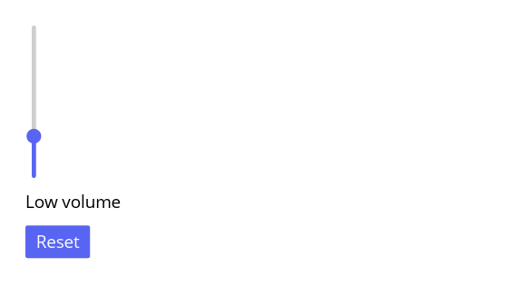

# VerticalSlider



Move the handle to propose a new volume. With `iced.run_events`, update receives `SliderChanged(id, value)`; changing the model determines the value shown by the next view. Use distinct nonzero IDs and an inclusive `u16` range with `minimum < maximum`. Reset sends an ordinary `Action(id)`.

From `examples/gui/iced_widgets`, run `plenty run --bin vertical_slider`. To dispatch a value followed by Reset without opening a window, add `-- --headless 1=75 2`.

```plenty build
{{#include ../../../../../examples/gui/iced_widgets/src/vertical_slider.plenty}}
```
