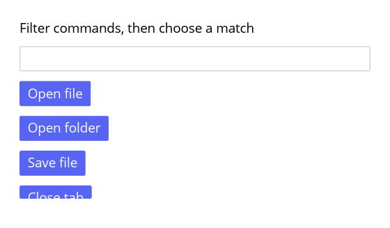

# Windowed counters and a command picker

Which part of a click changes the model? Try the two complete source packages
`examples/gui/iced_counter` and `examples/gui/egui_counter` with the
[GUI build instructions](../../design/stdlib/gui-build.md). Each defines a
Plenty `State` with an integer field, provides a factory, and propagates the
result of `run` from `main`. The iced example passes `create`, `view`, and `update` to `run`. The egui
example passes ordinary functions to `run(create=create, draw=draw)`; the
toolkit borrows the driver while Plenty owns the state.

**Retained:** read `iced_counter/src/main.plenty`. The shared `view` loan
submits a label and two buttons with distinct action IDs. A click calls
`update` with an exclusive loan: only this callback changes the model. The
new view reflects the new count. Try `plenty run -- --headless 1 1 2`: these
actions produce `Count: 0`, `1`, `2`, `0`. The teaching counter deliberately
reports `LimitExceeded` at a million instead of wrapping or ignoring input.

**Immediate:** read `egui_counter/src/main.plenty`. `draw` has the exclusive
loan. The order here is the interaction order:

```plenty fragment
if ui.button(&"Increment")?:
    state.increment().map_error(count_limit)?
if ui.button(&"Reset")?:
    state.count = 0
label = f"Count: {state.count}".map_error(egui.allocation)?
ui.label(&label)
```

`?` separates a failed button call from a successful call with no click.
`plenty run -- --headless 20,15 20,15 20,36` feeds real pointer events to
egui and prints the painted labels. The same value appears on several frames:
redrawing is not another click. In either package `plenty run` without the
headless arguments opens the native window on your own display. The runners
read all process arguments themselves: passing a filename instead of
`--headless` returns an error, not a window for that file. Never store
a frame/UI token for a later callback.

## Filtering commands as you type

Run `plenty run` in `examples/gui/egui_command_picker` using the same
[source setup](../../design/stdlib/gui-build.md). Click the field and type
`file`: only **Open file** and **Save file** remain. Press Enter without modifiers to display
**Selected: Open file**. Nothing is executed. A case-sensitive substring
filter and the original command order make the first match predictable;
submitting an empty result leaves the previous selection alone.

```plenty fragment
mut select = ui.text_edit(1u64, &mut state.query)?
for command in &state.commands:
    if state.query in *command:
        ui.label(command)?
        if select:
            state.selected = *command
            select = False
```

The edit, filter and selection all happen in `draw`. The field always has
ID `1u64`, whether four commands match or none. The toolkit remembers where
you were typing; the string in `State` is the source of truth. There is no
second filtered list to allocate and synchronize. `?` propagates a rejected
edit; it does not overwrite the query with an empty string. See the
[single-line editing contract](../../design/stdlib/gui-egui.md#editing-a-single-line).

## A retained command picker



Run `plenty run` in `examples/gui/iced_command_picker`. Type **file** and click
**Save file**. Now type a query with no matches: the rows disappear but
**Selected: Save file** remains. Selecting a command records its name; it never executes it.

The field sends a `TextChanged` event. Only `update` changes the query or selection;
`view` derives the matching buttons without storing another list. Each command
keeps its action ID when other rows disappear. To try the same transitions
without a window, run `plenty run -- --headless 1:file 4 1:zzz`.

```plenty build
{{#include ../../../../examples/gui/iced_command_picker/src/main.plenty}}
```
